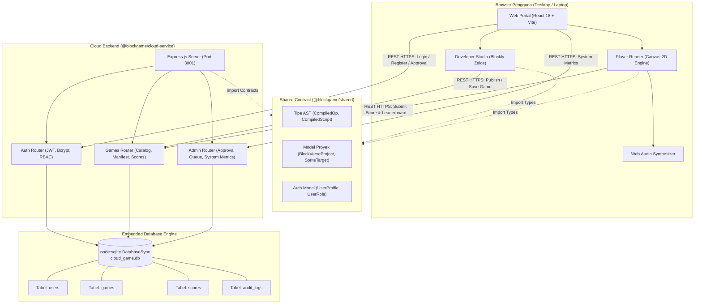
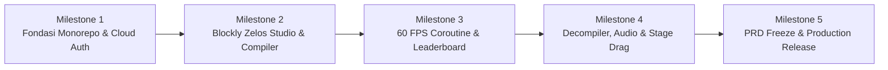

# Product Requirements Document (PRD) — BlockVerse

## Platform Pembuatan & Distribusi Game 2D Cloud Berbasis Visual Block Programming & Coroutine Runtime

> **Catatan nama produk:** Nama produk resmi adalah **BlockVerse (2D Cloud Game Platform)**. Seluruh identifier teknis monorepo menggunakan scope `@blockgame/*` (`@blockgame/shared`, `@blockgame/cloud-service`, `@blockgame/web-portal`), sehingga penamaan terstruktur rapi dan konsisten di seluruh package npm.

| Atribut | Nilai |
|---|---|
| Versi dokumen | **2.0-rc (menuju freeze prd-v1.0)** |
| Tanggal | 9 November 2026 |
| Status | Release Candidate, Production Ready |
| Pemilik dokumen | Product & Tech Lead (LiZUie) |
| Tim | Full-Stack Cloud & Web Engineering Team |
| Draft sebelumnya | [archive/PRD-blockverse-v1-draft.md](archive/PRD-blockverse-v1-draft.md) |

> **Aturan isi PRD:** PRD ini hanya berisi hal yang stabil, yaitu *apa* yang dibangun dan *kenapa*. Detail yang mudah berubah (skema payload JSON, konfigurasi port, implementasi fungsi runtime, dan tabel database SQLite) didefinisikan secara deklaratif di packages kode monorepo (`packages/shared`, `packages/cloud-service`, `packages/web-portal`). Dengan begitu PRD tetap konsisten dan tidak usang saat detail kodingan berkembang.

---

## Daftar Isi

1. [Ringkasan](#1-ringkasan)
2. [Latar Belakang & Masalah](#2-latar-belakang--masalah)
3. [Tujuan & Sasaran Terukur](#3-tujuan--sasaran-terukur)
4. [Scope & Non-Goals](#4-scope--non-goals)
5. [Personas](#5-personas)
6. [Fitur](#6-fitur)
7. [User Stories & Acceptance Criteria](#7-user-stories--acceptance-criteria)
8. [Non-Functional Requirements (NFR)](#8-non-functional-requirements-nfr)
9. [Constraints](#9-constraints)
10. [Arsitektur Logis (Ringkas)](#10-arsitektur-logis-ringkas)
11. [Roles & Ownership](#11-roles--ownership)
12. [Milestones](#12-milestones)
13. [Risiko & Mitigasi](#13-risiko--mitigasi)
14. [Success Metrics & SLO](#14-success-metrics--slo)
15. [Change Control](#15-change-control)
16. [Open Questions & Decision Log](#16-open-questions--decision-log)
17. [Glossary](#17-glossary)
18. [Referensi](#18-referensi)
19. [Changelog](#19-changelog)

---

## 1. Ringkasan

**BlockVerse** adalah platform User-Generated Content (UGC) game 2D berbasis cloud yang memungkinkan kreator merakit game interaktif langsung di browser menggunakan pemrograman visual blok puzzle (menggunakan renderer Google Blockly Zelos yang identik dengan Scratch 3.0), menyimpan proyek secara instan ke Cloud Service mandiri, dan mendistribusikannya ke para pemain untuk dimainkan pada frame rate 60 FPS dengan integrasi papan skor global (*Cloud Leaderboard*).

Platform ini dibangun dengan arsitektur **Monorepo TypeScript modern** yang terdiri dari tiga komponen utama:
1. **Cloud Service Backend** (`packages/cloud-service`): Express.js REST API dengan database embedded `node:sqlite` (zero-external database dependency), JWT Authentication, dan Role-Based Access Control (RBAC) 3 peran (Admin, Developer, Player) beserta antrean moderasi persetujuan akun developer (*Approval Workflow*).
2. **Shared Contract Package** (`packages/shared`): Kontrak antarmuka tipe data universal (`GameManifest`, `BlockVerseProject`, `SpriteTarget`, `CompiledScript`, `UserProfile`, dll.).
3. **Web Portal Frontend** (`packages/web-portal`): Aplikasi web SPA (React 18, Vite, Tailwind CSS, Blockly) yang mencakup **Developer Studio** (3-kolom ala Scratch 3.0, Dynamic Dropdowns, Decompiler otomatis `scriptsToBlocklyXml`, Stage Drag-and-Drop, Costumes & Backdrop Editor, Web Audio Synthesizer), **Player Runner Client** (60 FPS Canvas Coroutine Engine), dan **Cloud Admin Monitoring Dashboard**.

Sistem dirancang mandiri (*Zero-Config On-Premise / Private Local Cloud*); siapa pun yang mengkloning repository dapat langsung menjalankan seluruh ekosistem hanya dengan menjalankan `npm install` dan `npm run dev` pada Node.js 22+.

---

## 2. Latar Belakang & Masalah

- **Tingginya Hambatan Teknis Pembuatan Game Konvensional:** Game engine modern seperti Unity, Unreal, atau Godot membutuhkan instalasi software berukuran gigabyte, pemahaman bahasa kode teks yang rumit (C#, C++, GDScript), serta hardware komputer berspesifikasi tinggi. Hal ini membatasi pemula, siswa sekolah, dan kreator independen untuk berekspresi.
- **Keterbatasan Ekosistem Scratch Standar:** Platform edukasi seperti Scratch MIT sangat baik untuk belajar logika visual, tetapi tidak memiliki arsitektur backend cloud database mandiri untuk distribusi game UGC, autentikasi multi-peran dengan moderasi akun developer, maupun API REST publik untuk sinkronisasi papan skor antar-perangkat di jaringan lokal.
- **Kebutuhan Hiburan Kasual 2D yang Ringan & Instan:** Pemain menginginkan game kasual 2D (*arcade, platformer, catcher*) yang dapat langsung dimainkan di browser ponsel atau laptop sekolah tanpa perlu proses instalasi atau unduhan besar.
- **Kebutuhan Infrastruktur Edukasi Berbiaya Nol (Zero-Bill Cloud):** Institusi pendidikan dan laboratorium komputer memerlukan platform game cloud yang bisa di-hosting sendiri secara lokal (*Local LAN / Private Cloud*) tanpa resiko tagihan langganan bulanan cloud publik yang mahal.
- **Kesempatan Demonstrasi Arsitektur Perangkat Lunak Nyata:** Bagi tim pengembang, proyek ini adalah bukti implementasi arsitektur perangkat lunak berskala industri: Monorepo workspaces, arsitektur AST (*Abstract Syntax Tree*), thread scheduling non-blocking coroutines, Web Audio synthesizer, dan integrasi compiler-decompiler dua arah.

---

## 3. Tujuan & Sasaran Terukur

### 3.1 Tujuan Produk

- **G1.** Kreator dapat membuat game 2D menggunakan blok visual puzzle Scratch 3.0 tanpa perlu mengetik kode teks dan tanpa instalasi aplikasi software.
- **G2.** Game buatan kreator dieksekusi secara mulus pada kecepatan 60 FPS di browser menggunakan mesin runtime berbasis *non-blocking coroutines*.
- **G3.** Cloud Service mampu menyimpan manifest game, mengelola registrasi & hak akses 3 peran (Admin, Developer, Player), menjalankan alur persetujuan akun developer, dan mencatat rekor skor tertinggi (*Top 10 Leaderboard*).
- **G4.** Siapa pun dapat melakukan replikasi dan *mirroring* sistem secara instan (*Zero-Config Deployment*) dengan `npm run dev` di Node.js 22+.

### 3.2 Sasaran Terukur (v1.0)

Semua sasaran memiliki metode pengukuran yang dijabarkan pada [§8](#8-non-functional-requirements-nfr) dan [§14](#14-success-metrics--slo).

| ID | Sasaran | Target | Metode Pengukuran |
|---|---|---|---|
| T-1 | Frame rate eksekusi game di Player & Studio | Steady 60 FPS (frame time ≤ 16.6 ms) | `requestAnimationFrame` delta timestamp di Canvas 2D |
| T-2 | Waktu Decompile Script ke Blok Visual | < 50 ms untuk 100 blok visual | Benchmark fungsi `scriptsToBlocklyXml` pada pergantian sprite |
| T-3 | Page Load (LCP halaman portal utama) | < 1.8 detik | Pengujian Google Lighthouse pada koneksi standar |
| T-4 | Latensi API REST Backend (Simpan Game & Skor) | p95 < 40 ms | Profiling HTTP request ke embedded `node:sqlite` |
| T-5 | Memory Footprint Web Portal di Browser | < 90 MB RAM saat game aktif | Chrome DevTools Memory Heap Snapshot |
| T-6 | Ketersediaan Endpoint API Cloud | ≥ 99.5% request non-5xx | Automated integration test suite (`npm test`) |
| T-7 | Biaya Operasional Infrastruktur | Rp 0 / $0 (Local host / Free Tier ready) | Evaluasi dependency dan zero third-party billing |

---

## 4. Scope & Non-Goals

### 4.1 In Scope (v1.0 dan v1.1)

Pengelompokan fitur menggunakan prioritas **MoSCoW**:

#### Must Have (v1.0 — Wajib Ada untuk Rilis)
- **Monorepo TypeScript Workspace**: Integrasi `@blockgame/shared`, `@blockgame/cloud-service`, dan `@blockgame/web-portal`.
- **Autentikasi & RBAC 3-Peran**: Login, registrasi akun, proteksi JWT Token (7 hari kedaluwarsa), dan pemisahan hak akses:
  - `ADMIN`: Akses Cloud Admin Dashboard, moderasi antrean developer (`PENDING` → `ACTIVE`/`REJECTED`), moderasi katalog game.
  - `DEVELOPER`: Akses Developer Studio jika status `ACTIVE`. Jika `PENDING`, dikunci di landing page antrean approval.
  - `PLAYER`: Akses Katalog Game dan Player Runner Client.
- **Developer Studio Visual Scratch 3.0**:
  - Layout 3-kolom resmi: Kategori Rail, Workspace Google Blockly Zelos, Stage Simulator (480x360), dan Sprite Inspector Bar.
  - 8 Kategori Blok Lengkap: *Motion, Looks, Sound, Events, Control, Sensing, Operators, Variables*.
  - Dynamic Dropdown: Opsi blok `touching [...] ?`, `create clone of [...]`, variabel, dan broadcast pesan yang otomatis membaca data sprite aktif.
  - Decompiler Otomatis (`scriptsToBlocklyXml`): Mengubah skrip JSON menjadi puzzle visual saat membuka preset atau mengganti sprite.
  - Direct Stage Drag-and-Drop: Menggeser posisi karakter langsung di layar Stage dengan mouse.
  - Tab Costumes & Backdrop: Galeri 24 emoji single-codepoint, upload gambar PNG/SVG kustom, pemilih tema latar (*Grid, Sky, Stars, Dungeon*), dan hex color picker.
  - Tab Sounds: Web Audio API Synthesizer bawaan untuk memainkan efek suara (*coin, jump, laser, hit, win*) tanpa file MP3 eksternal.
  - Cloud Save & Publish: Menyimpan status `DRAFT` atau mempublikasikan `PUBLISHED` langsung ke Cloud SQLite.
- **60 FPS BlockVerse Engine Runtime**:
  - Non-blocking coroutines scheduler (hingga 35 instruksi/tick tanpa freeze).
  - Evaluasi logika matematika, komparasi bilangan, deteksi tabrakan lingkaran berbasis bounding radius, input keyboard, dan posisi mouse.
  - Mekanisme kloning sprite dinamis (`CREATE_CLONE`, `DELETE_CLONE`, `WHEN_CLONE_START`).
- **Player Runner Client**:
  - Eksekusi game kanvas 480x360 terisolasi.
  - Pengiriman skor otomatis ke endpoint `POST /api/games/:id/scores`.
  - Top 10 Live Cloud Leaderboard dengan fallback akun guest.
- **Katalog Game & Template Bawaan**:
  - Template game siap pakai: *Cat & Star Catcher* (Default), *Coin Hunter RPG*, *Space Invaders*, dan *Blank Canvas*.

#### Should Have (v1.1)
- Tombol Switch cepat antara Blockly Zelos Studio dan Classic Studio di pojok header.
- Filter pencarian dan kategori game di halaman Katalog.
- Menu profil pengguna dengan badge peran (*Role Badge*), status akun, detail email, dan tombol Logout.

#### Could Have (Masa Depan)
- Fitur Physics / Gravity terintegrasi untuk game platformer (seperti Mario/Flappy Bird).
- Ekspor game menjadi file standalone HTML offline.

### 4.2 Non-Goals / Won't Have (v1)

- **Engine Grafis 3D**: Platform berfokus murni pada game 2D berbasis grid dan pixel koordinat.
- **Sinkronisasi Multiplayer Real-Time PvP via WebSocket**: Game v1 berjalan di client masing-masing dengan kompetisi berbasis papan skor asinkron (*Leaderboard*).
- **Monetisasi & Pembayaran Mikro (In-App Purchases)**: Tidak ada fitur transaksi finansial atau pembelian item digital berbayar di v1.
- **Penyunting Sprite Vektor Tingkat Lanjut (SVG Path Editor)**: Studio hanya mendukung pemilihan aset emoji dan pengunggahan file gambar jadi (PNG/SVG/GIF).

---

## 5. Personas

### Persona 1: Arsa (17 tahun, Siswa SMK / Kreator Pemula) — Role: Developer
- **Latar Belakang:** Tertarik membuat game tetapi frustrasi saat belajar Unity karena laptopnya lambat dan sintaksis C# membingungkan.
- **Kebutuhan:** Ingin langsung menuangkan ide game sederhana (seperti kucing menangkap bintang atau pesawat luar angkasa) lewat antarmuka blok seret-lepas ala Scratch, lalu bisa langsung membagikan link game tersebut ke teman sekelasnya.
- **Masalah:** Scratch resmi tidak memiliki database cloud untuk menyimpan skor global teman-temannya dan tidak ada sistem manajemen hak cipta pengembang.
- **Perilaku:** Membuka Developer Studio lewat browser laptop, mendesain latar dan kostum sprite, menyusun puzzle logika, melakukan playtest di Stage, lalu menekan tombol "Share to Player Cloud".

### Persona 2: Budi (20 tahun, Mahasiswa / Casual Gamer) — Role: Player
- **Latar Belakang:** Ingin hiburan cepat di sela-sela jam kuliah tanpa harus mengunduh game berat di Play Store atau Steam.
- **Kebutuhan:** Membuka katalog game lewat browser ponsel atau laptop, memilih game kasual 2D yang seru, memainkannya secara instan, dan berusaha mengalahkan rekor skor tertinggi teman-temannya di Leaderboard.
- **Masalah:** Game web konvensional sering lambat, penuh iklan, atau memerlukan registrasi yang berbelit-belit.
- **Perilaku:** Membuka URL game, membaca kontrol panah / tombol keyboard, bermain game hingga selesai, dan melihat namanya tercatat di posisi puncak Top 10 Leaderboard.

### Persona 3: Pak Hendra (38 tahun, Dosen / Administrator Lab) — Role: Admin
- **Latar Belakang:** Pengajar mata kuliah rekayasa web dan komputasi awan yang bertanggung jawab atas server laboratorium.
- **Kebutuhan:** Menjalankan satu laptop/server lokal sebagai pusat Cloud Service, mengontrol siapa saja yang berhak mempublikasikan game melalui antrean persetujuan developer (*Approval Workflow*), serta memastikan server tidak kehabisan memori atau kebobolan konten ilegal.
- **Masalah:** Banyak platform game memerlukan konfigurasi server database yang rumit (Postgres/Redis terpisah) yang sulit dipelihara oleh mahasiswa pemula.
- **Perilaku:** Membuka Dasbor Admin, memantau metrik uptime dan memori sistem, meninjau akun developer baru yang berstatus `PENDING`, lalu memberikan persetujuan (*Approve*) atau penolakan (*Reject*).

---

## 6. Fitur

### 6.1 Model Peran di Dalam Platform

Sistem menerapkan Role-Based Access Control (RBAC) ketat yang diverifikasi di level backend Express middleware (`authenticateToken`, `requireRole`, `requireActiveAccount`).

| Peran (*Role*) | Status Akun | Akses Katalog | Akses Player Runner | Akses Developer Studio | Akses Admin Dashboard | Publish Game ke Cloud |
|---|---|---|---|---|---|---|
| `ADMIN` | `ACTIVE` | Ya | Ya | Ya | Ya | Ya |
| `DEVELOPER` | `ACTIVE` | Ya | Ya | Ya | Tidak | Ya |
| `DEVELOPER` | `PENDING` | Tidak | Tidak | Layar Antrean Approval | Tidak | Tidak |
| `DEVELOPER` | `REJECTED`| Tidak | Tidak | Layar Ditolak | Tidak | Tidak |
| `PLAYER` | `ACTIVE` | Ya | Ya | Tidak (Ditolak) | Tidak | Tidak |
| `Guest` (Anonim) | N/A | Ya | Ya | Tidak (Redirect Login)| Tidak | Tidak |

**Aturan Bisnis Platform (Business Rules):**
- **BR-1 (Registrasi Developer):** Setiap akun baru yang mendaftar sebagai `DEVELOPER` secara otomatis berstatus `PENDING` dan masuk ke antrean approval Admin.
- **BR-2 (Isolasi Developer Pending):** Developer berstatus `PENDING` dikunci secara penuh di halaman `DeveloperPendingView` dan tidak dapat masuk ke katalog maupun studio sebelum disetujui.
- **BR-3 (Hak Moderasi Admin):** Admin memiliki hak mutlak menyetujui (`ACTIVE`), menolak (`REJECTED`), atau menghapus game apa pun dari database cloud.
- **BR-4 (Isolasi Player):** Akun dengan peran `PLAYER` dilarang membuka `StudioView` (menu Studio Blok disembunyikan dari navigasi, dan tombol "Buat Game Baru" di katalog dinonaktifkan).
- **BR-5 (Kompabilitas Format Proyek):** Endpoint `POST /api/games` wajib mendukung payload modern `{ projectData }` dari Blockly Zelos sekaligus menjaga kompatibilitas ke belakang (*backward compatibility*) dengan skema `{ canvas, entities, logic }`.
- **BR-6 (Dual-Endpoint Papan Skor):** Endpoint pengiriman skor menerima alias tunggal `POST /api/games/:id/score` dan jamak `POST /api/games/:id/scores`. Pengguna tamu (*Guest*) tetap diizinkan mengirim skor dengan fallback username `GuestPlayer`.
- **BR-7 (Inisialisasi Database Otomatis):** Jika file database SQLite belum ada, sistem wajib membuat tabel secara mandiri dan mengisikan data awal (*Seeding*) untuk Admin, Developer, Player, dan 4 game default.
- **BR-8 (Workspace Isolation):** Setiap sprite di Developer Studio memiliki workspace Blockly yang terisolasi. Pergantian antar sprite menyimpan state JSON sprite lama dan memuat state sprite yang baru dipilih.

---

### 6.2 Daftar Fitur

Daftar fitur diklasifikasikan menggunakan prioritas MoSCoW:

| ID | Modul | Nama Fitur | Deskripsi | Prioritas |
|---|---|---|---|---|
| F-1.1 | Auth | Layar Gerbang Login | Autentikasi JWT dengan username/email dan password, mengarahkan otomatis sesuai role | **Must** |
| F-1.2 | Auth | Registrasi Multi-Role | Pendaftaran akun dengan pilihan peran Developer atau Player | **Must** |
| F-1.3 | Auth | Profil & Menu Logout | Dropdown avatar dengan detail status akun, user ID, badge role, dan tombol logout | **Must** |
| F-1.4 | Auth | Antrean Approval Developer | Workflow persetujuan akun developer berstatus `PENDING` oleh Admin | **Must** |
| F-2.1 | Studio | UI 3-Kolom Scratch 3.0 | Layout resmi dengan Category Rail, Workspace Blockly Zelos, Stage, dan Inspector | **Must** |
| F-2.2 | Studio | 8 Kategori Blok Lengkap | Blok Motion, Looks, Sound, Events, Control, Sensing, Operators, Variables | **Must** |
| F-2.3 | Studio | Dynamic Context Dropdowns | Opsi dropdown touching, clone, variable, dan message yang otomatis sinkron dengan state sprite | **Must** |
| F-2.4 | Studio | Decompiler Otomatis | Mengubah array `CompiledScript[]` menjadi blok visual di kanvas (`scriptsToBlocklyXml`) | **Must** |
| F-2.5 | Studio | Stage Drag-and-Drop | Fitur menggeser koordinat posisi sprite langsung di atas kanvas simulator menggunakan mouse | **Must** |
| F-2.6 | Studio | Tab Costumes & Backdrop | Pemilihan emoji karakter, upload gambar kustom (PNG/SVG), dan tema panggung (*Sky, Space, Grid, Dungeon*) | **Must** |
| F-2.7 | Studio | Tab Sound & Synthesizer | Web Audio API Synthesizer bawaan untuk memainkan suara *coin, jump, laser, hit, win* | **Must** |
| F-2.8 | Studio | Sticky Notes Kuning | Fitur menambahkan catatan tempel kuning di atas kanvas blok untuk dokumentasi logika | **Should** |
| F-2.9 | Studio | Multi-Preset Selector | Dropdown untuk memilih template: Cat & Star Catcher, Blank Project, Coin Hunter, Space Invaders | **Must** |
| F-3.1 | Engine | 60 FPS Coroutine Runtime | Eksekutor skrip non-blocking berbasis *thread loop stack* pada HTML5 Canvas 2D | **Must** |
| F-3.2 | Engine | Kloning Sprite Dinamis | Kemampuan membuat (*create clone*) dan menghapus (*delete clone*) instance sprite di memori | **Must** |
| F-3.3 | Engine | Deteksi Tabrakan Presisi | Deteksi tabrakan antar-entitas, tepi layar (*edge*), dan kursor mouse (*mouse-pointer*) | **Must** |
| F-4.1 | Player | Player Runner Standalone | Klien eksekusi game 480x360 terisolasi untuk pemain | **Must** |
| F-4.2 | Player | Live Cloud Leaderboard | Sinkronisasi skor tertinggi ke database dan penayangan daftar Top 10 pemain | **Must** |
| F-5.1 | Cloud | REST API Game & Katalog | Endpoint pencarian game, pengambilan manifest, publikasi game baru, dan update | **Must** |
| F-5.2 | Cloud | Embedded SQLite Database | Penyimpanan relasional persisten menggunakan modul bawaan `node:sqlite` | **Must** |
| F-6.1 | Admin | Dasbor Metrik Cloud | Pemantauan pemakaian memori server, uptime sistem, total game, dan total pengguna | **Must** |
| F-6.2 | Admin | Moderasi Konten Game | Hak menghapus game dan skor dari database cloud | **Must** |

---

### 6.3 Graceful Degradation (Ketahanan Sistem)

- **Offline / Server Terputus saat Menyimpan Proyek Studio:** Jika jaringan lokal atau backend Express (port 3001) terputus saat developer menekan tombol "Save", Studio secara otomatis melakukan fallback penyimpanan ke browser `localStorage` (`blockverse_latest_project`) dengan status pemberitahuan `Published (Local Cache)!`. Proyek tidak akan hilang.
- **Pemain Tanpa Login (Guest Mode):** Pemain yang belum login tetap dapat memainkan seluruh game di katalog dan mengirimkan skor ke papan peringkat; sistem otomatis memberikan fallback identitas `user_guest` dengan username `GuestPlayer`.
- **Browser Tanpa Dukungan Web Audio API:** Jika browser memblokir audio autoplay atau Web Audio API tidak tersedia, fungsi `playSynthSound()` dibungkus dalam blok `try...catch` yang aman sehingga game tetap berjalan tanpa crash.
- **Rendering Kostum Gambar Gagal Dimuat:** Jika URL gambar kustom sprite gagal dimuat atau rusak, canvas runtime secara otomatis beralih menampilkan fallback karakter `costumeEmoji` bawaan.

---

## 7. User Stories & Acceptance Criteria

### Epic 1: Autentikasi & Manajemen Akun

#### US-1.1 (F-1.1) — Login Pengguna
Sebagai pengguna (Admin, Developer, atau Player), saya ingin masuk ke platform menggunakan akun terdaftar agar dapat mengakses fitur yang sesuai dengan peran saya.
- **AC-1.1.1** Given pengguna berada di halaman login dengan username dan password yang benar, When pengguna menekan "Masuk ke Sistem", Then token JWT disimpan di `localStorage` dan pengguna diarahkan ke antarmuka sesuai perannya.
- **AC-1.1.2** Given kredensial yang dimasukkan salah, When form login dikirim, Then sistem menampilkan pesan error `Username atau password salah` dan pengguna tetap berada di halaman login.
- **AC-1.1.3** Given token JWT sudah kedaluwarsa, When aplikasi dimuat, Then sesi otomatis dibersihkan dan pengguna diarahkan kembali ke gerbang login.

#### US-1.2 (F-1.4) — Alur Persetujuan Akun Developer
Sebagai developer yang baru mendaftar, saya ingin mengetahui status persetujuan akun saya agar saya tahu kapan saya bisa mulai membuat game.
- **AC-1.2.1** Given pengguna mendaftar sebagai `DEVELOPER`, When registrasi berhasil, Then akun memiliki status `PENDING` dan pengguna langsung dikunci di halaman `DeveloperPendingView`.
- **AC-1.2.2** Given developer berstatus `PENDING`, When mencoba mengakses katalog atau studio, Then sistem memblokir akses dan menampilkan status "Menunggu Persetujuan Admin".
- **AC-1.2.3** Given Admin menekan tombol "Approve" pada antrean akun developer, When developer menekan tombol "Refresh Status", Then status akun berubah menjadi `ACTIVE` dan halaman langsung dialihkan ke Developer Studio.

---

### Epic 2: Developer Studio & Pemrograman Visual

#### US-2.1 (F-2.1, F-2.2) — Penyusunan Logika Blok Puzzle
Sebagai developer aktif, saya ingin merakit logika interaktif game menggunakan blok puzzle Scratch 3.0 agar game dapat bergerak dan merespons aksi keyboard.
- **AC-2.1.1** Given developer berada di Studio pada tab Code, When developer mengklik kategori *Motion* dan menyeret blok `move (10) steps` ke bawah blok `when flag clicked`, Then blok visual terhubung secara magnetis dengan bentuk puzzle yang presisi.
- **AC-2.1.2** Given susunan blok diubah di workspace, When event perubahan terpicu, Then sistem otomatis mengompilasi blok tersebut menjadi AST `CompiledScript[]` dan menyimpannya di memori state sprite aktif.

#### US-2.2 (F-2.3) — Dynamic Dropdowns
Sebagai developer, saya ingin opsi dropdown pada blok target otomatis menampilkan nama sprite dan variabel saya agar saya tidak salah memilih target interaksi.
- **AC-2.2.1** Given developer menambahkan sprite baru bernama `Koin`, When developer membuka blok `touching [...] ?` pada sprite Hero, Then opsi `Koin` langsung muncul di urutan teratas dropdown bersama `edge` dan `mouse-pointer`.
- **AC-2.2.2** Given developer membuat variabel baru `darah`, When developer membuka blok `set [...] to`, Then opsi `darah` otomatis tersedia di dalam dropdown variabel.

#### US-2.3 (F-2.4) — Visual Decompiler Otomatis
Sebagai developer, saya ingin saat memilih template game atau berpindah sprite, kanvas visual langsung menampilkan tumpukan blok puzzle yang ada agar saya bisa langsung mengeditnya.
- **AC-2.3.1** Given developer memilih template *Cat & Star Catcher*, When sprite Hero dipilih, Then kanvas visual langsung menampilkan susunan blok `when flag clicked`, loop `forever`, dan kondisi tombol panah tanpa kanvas kosong.
- **AC-2.3.2** Given sprite baru ditambahkan tanpa skrip, When sprite tersebut dipilih, Then kanvas visual menampilkan lembar kerja kosong yang bersih dan siap diisi.

#### US-2.4 (F-2.5) — Direct Stage Drag-and-Drop
Sebagai developer, saya ingin menggeser sprite langsung di atas layar panggung simulator dengan mouse agar penentuan posisi awal lebih intuitif.
- **AC-2.4.1** Given game dalam keadaan stop, When developer mengklik karakter kucing di Stage dan menyeretnya ke koordinat baru, Then posisi karakter berpindah secara real-time di layar.
- **AC-2.4.2** When mouse dilepas setelah drag, Then input angka `x` dan `y` di Sprite Inspector Bar otomatis terbarui sesuai koordinat pelepasan.

---

### Epic 3: Kustomisasi & Synthesizer Suara

#### US-3.1 (F-2.6) — Kustomisasi Kostum & Latar Belakang
Sebagai developer, saya ingin mengubah tampilan sprite dan latar panggung game agar sesuai dengan tema cerita game saya.
- **AC-3.1.1** Given developer membuka tab *Costumes & Backdrop*, When memilih tema *🌤️ Padang Rumput & Langit*, Then latar belakang Stage 480x360 berubah menjadi gradasi langit biru dan rumput hijau.
- **AC-3.1.2** Given developer mengunggah file gambar PNG karakter, When upload selesai, Then sprite di Stage langsung di-render menggunakan gambar tersebut menggantikan emoji default.

#### US-3.2 (F-2.7) — Efek Suara Web Audio
Sebagai developer, saya ingin menambahkan efek suara saat koin diambil atau terjadi ledakan agar game terasa hidup.
- **AC-3.2.1** Given developer meletakkan blok `play sound [coin]` di dalam kondisi tabrakan koin, When sprite menyentuh koin saat game berjalan, Then browser memutar nada synthesizer koin secara instan tanpa lag.
- **AC-3.2.2** Given developer berada di tab *Sounds*, When menekan tombol "Test Sound", Then audio synthesizer memutar pratinjau frekuensi suara yang dipilih.

---

### Epic 4: Distribusi & Eksekusi Pemain

#### US-4.1 (F-4.1, F-4.2) — Bermain Game & Kirim Skor
Sebagai pemain, saya ingin memainkan game dari katalog dan melihat skor saya tercatat di papan peringkat agar saya bisa berkompetisi dengan pemain lain.
- **AC-4.1.1** Given pemain membuka salah satu game dari katalog, When halaman Player Runner terbuka, Then game langsung berjalan pada 60 FPS dan merespons kontrol keyboard panah/spasi.
- **AC-4.1.2** When game memicu blok `submit score`, Then skor otomatis dikirimkan ke `POST /api/games/:id/scores` dan papan peringkat Top 10 di samping layar langsung terbarui menampilkan peringkat pemain.

---

## 8. Non-Functional Requirements (NFR)

### 8.1 Performance

| ID | Requirement | Target | Metode Pengukuran |
|---|---|---|---|
| NFR-1.1 | Canvas Rendering Frame Rate | Steady 60 FPS (≥ 58 FPS rata-rata) | Diukur menggunakan kalkulasi delta timestamp `requestAnimationFrame` selama sesi bermain 60 detik. |
| NFR-1.2 | Coroutine Thread Execution Budget | ≤ 35 op/tick tanpa frame drop | Benchmark batas iterasi loop thread scheduler di `BlockVerseRuntime.stepThreads()`. |
| NFR-1.3 | Compiler & Decompiler Latency | < 50 ms untuk 100 node blok | Waktu eksekusi fungsi `compileWorkspaceToScripts` dan `scriptsToBlocklyXml` menggunakan `performance.now()`. |
| NFR-1.4 | SQLite Query Response Time | p95 < 25 ms untuk query katalog dan submit skor | Logging durasi eksekusi statement `db.prepare().run()` pada backend Express. |
| NFR-1.5 | Initial Asset Load Bundle Size | Gzip bundle JS < 300 KB | Output analisis build `npm run build` menggunakan Vite Rollup visualizer. |

### 8.2 Reliability

| ID | Requirement | Target | Metode Pengukuran |
|---|---|---|---|
| NFR-2.1 | Toleransi Infinite Loop di Skrip Blok | Zero browser freeze (UI tidak hang) | Uji coba blok `forever` tanpa jeda; thread scheduler wajib melakukan yielding per tick. |
| NFR-2.2 | Autosave LocalStorage Fallback | 100% data terselamatkan saat backend offline | Mematikan service backend saat tombol save diklik, memverifikasi ketersediaan data di `localStorage`. |
| NFR-2.3 | Database Integrity & Foreign Key Safety | Zero unhandled sqlite exception | Uji pengiriman skor dari user guest dan akun terdaftar menggunakan automated API tests. |

### 8.3 Security & Privacy

| ID | Requirement | Target | Metode Pengukuran |
|---|---|---|---|
| NFR-3.1 | Password Hashing | Enkripsi bcrypt satu arah dengan salt cost 10 | Pemeriksaan kolom `password_hash` di database SQLite (tidak ada plaintext). |
| NFR-3.2 | API Route Authorization | 100% rute sensitif dilindungi middleware | Unit test pengiriman request tanpa token atau dengan role yang tidak sesuai (wajib return 401/403). |
| NFR-3.3 | XSS Prevention pada Custom Image & Text | Sanitasi input teks balon ucapan & SVG upload | Pengujian payload `<script>` pada input teks nama sprite dan balon pesan `say`. |

### 8.4 Compatibility

| ID | Requirement | Target | Metode Pengukuran |
|---|---|---|---|
| NFR-4.1 | Kompatibilitas Browser Modern | Berjalan mulus di Chrome, Firefox, Safari, Edge | Uji lintas browser pada versi rilis 2 tahun terakhir. |
| NFR-4.2 | Responsivitas Tampilan Studio | Minimal resolusi 1280x720 (Desktop/Laptop) | Pengujian layout 3-kolom pada layar 13" laptop dan monitor desktop standar. |

### 8.5 Operability & Cost

| ID | Requirement | Target | Metode Pengukuran |
|---|---|---|---|
| NFR-5.1 | Zero-Config Setup | Berjalan dengan 2 perintah: `npm i` & `npm run dev` | Pengujian instalasi segar di mesin laptop baru tanpa konfigurasi variabel environment eksternal. |
| NFR-5.2 | Zero Operational Cloud Bill | Biaya operasional hosting $0 / Rp 0 | Sistem dirancang mandiri untuk jaringan lokal atau hosting gratis (Vercel/Render/Railway free tier). |

---

## 9. Constraints (Batasan Proyek)

- **Batasan Runtime Node.js:** Platform memanfaatkan fitur built-in resmi `node:sqlite` (`DatabaseSync`) pada backend Express, sehingga **wajib dijalankan pada Node.js versi 22.5.0 ke atas** (tidak mendukung Node.js 18 atau 20 tanpa flag experimental).
- **Batasan Skala Database Lokal:** Database SQLite lokal dirancang optimal untuk skala jaringan lokal / LAN hingga ratusan transaksi konkuren. Untuk skala jutaan pengguna online simultan, skema tabel dirancang modular agar siap dimigrasikan ke PostgreSQL.
- **Dimensi Kanvas Panggung Terstandarisasi:** Ukuran layar stage dikunci pada rasio standar Scratch 4:3, yaitu **480x360 piksel** (koordinat x: -240 s.d. 240, koordinat y: -180 s.d. 180).
- **Limit Kloning Entitas:** Untuk mencegah kehabisan memori akibat pembuatan klon tanpa henti, engine membatasi jumlah klon aktif maksimal **150 entitas simultan**.

---

## 10. Arsitektur Logis (Ringkas)

Arsitektur monorepo dirancang dengan pemisahan tanggung jawab yang tegas antar-layer:

| Kebutuhan Sistem | Solusi Arsitektur | Keputusan Desain |
|---|---|---|
| Kontrak Tipe Data Bersama | Package npm workspace internal `@blockgame/shared` | Menjamin 100% konsistensi tipe data antara backend dan frontend |
| Database Cloud Mandiri | Modul bawaan Node 22 `node:sqlite` (`DatabaseSync`) | Zero instalasi database eksternal (Postgres/MySQL tidak diperlukan) |
| Visual Programming Studio | Google Blockly v13 dengan tema visual `zelos` | Replikasi 100% akurat puzzle Scratch 3.0 dengan performa rendering SVG cepat |
| Mesin Eksekusi Game | HTML5 Canvas 2D murni + Non-blocking Coroutines | Bebas lag 60 FPS tanpa overhead framework game pihak ketiga |
| Efek Suara Interaktif | Web Audio API Oscillator & Gain Synthesizer | Tanpa latency unduhan aset audio MP3, bekerja secara instan di browser |

---

## 11. Roles & Ownership

### 11.1 Role Pembagian Kerja Tim

| Role | Tanggung Jawab Utama | Komponen Kode Utama |
|---|---|---|
| **Product & Tech Lead** | Pemilik PRD, arsitektur monorepo, koordinasi rilis, code review, change control | `docs/`, `package.json`, konfigurasi workspace |
| **Backend & Database Engineer** | REST API Express, autentikasi JWT, middleware RBAC, query SQLite, testing | `packages/cloud-service/` |
| **Frontend Studio Engineer** | UI Developer Studio, integrasi Blockly Zelos, Tab Costumes & Sounds, Inspector | `packages/web-portal/src/components/`, `views/` |
| **Engine & Compiler Engineer** | 60 FPS Coroutine Runtime, AST Compiler, Decompiler `scriptsToBlocklyXml` | `packages/web-portal/src/engine/` |
| **QA & Security Engineer** | Verifikasi test suite, validasi input keamanan, uji lintas platform dan browser | `packages/cloud-service/src/test/`, build verification |

### 11.2 Matriks RACI

| Fitur / Deliverable | Tech Lead | Backend | FE Studio | Engine | QA |
|---|---|---|---|---|---|
| Desain PRD & Arsitektur Monorepo | **A** / R | C | C | C | I |
| Auth JWT & Approval Developer | A | **R** | C | I | C |
| Google Blockly Zelos & Dropdown Dinamis | A | I | **R** | C | C |
| Decompiler Otomatis `scriptsToBlocklyXml` | A | I | C | **R** | C |
| 60 FPS Canvas Runtime & Coroutines | A | I | C | **R** | C |
| Web Audio Synthesizer | A | I | C | **R** | I |
| SQLite Schema & REST Endpoints | A | **R** | I | I | C |
| Automated Integration Testing | A | C | C | C | **R** |

*(Keterangan: **R** = Responsible/Pengerja, **A** = Accountable/Penanggung Jawab, **C** = Consulted/Konsultan, **I** = Informed/Penerima Info).*

---

## 12. Milestones

- **Milestone 1 (Fondasi Monorepo & Cloud Auth) — *SELESAI***:
  Inisialisasi workspaces, konfigurasi Express backend, skema database SQLite, sistem autentikasi JWT 3 peran (Admin, Developer, Player), dan antrean moderasi persetujuan akun developer.
- **Milestone 2 (Blockly Zelos Studio & Compiler) — *SELESAI***:
  Integrasi library Google Blockly dengan renderer Zelos, definisi 8 kategori blok resmi Scratch 3.0, Category Rail berwarna, dan compiler AST (`compileWorkspaceToScripts`).
- **Milestone 3 (60 FPS Coroutine & Leaderboard) — *SELESAI***:
  Pengembangan engine `BlockVerseRuntime` berbasis loop stack non-blocking, rendering Canvas 480x360, pengiriman skor otomatis, dan tabel Top 10 Leaderboard.
- **Milestone 4 (Decompiler, Audio & Stage Drag) — *SELESAI***:
  Decompiler visual `scriptsToBlocklyXml`, Web Audio Synthesizer bawaan, Direct Stage Drag-and-Drop, Dynamic Context Dropdown, dan game default *Cat & Star Catcher*.
- **Milestone 5 (PRD Freeze & Release v1.0) — *TAHAP SAAT INI***:
  Penyusunan PRD komprehensif berstandar formal, validasi linting build produksi Vite, pembersihan dependensi, dan penguncian versi rilis (*Freeze tag*).

---

## 13. Risiko & Mitigasi

| Risiko | Probabilitas | Dampak | Strategi Mitigasi |
|---|---|---|---|
| **Infinite Loop Blok Pengguna Membekukan Browser** | Tinggi | Kritis | Thread scheduler mengeksekusi maksimal 35 instruksi per frame, lalu melakukan *yielding* otomatis ke browser animation frame. Game tidak pernah membuat tab browser hang. |
| **Gagal Menjalankan Database di Node Versi Lama (< 22)** | Sedang | Tinggi | Menambahkan dokumentasi prasyarat Node 22+ secara tegas di README, PRD, dan skrip `predev` pemeriksaan versi di root `package.json`. |
| **Kehilangan Proyek akibat Jaringan Lokal Terputus** | Sedang | Sedang | Mengimplementasikan mekanisme otomatis *fallback save* ke browser `localStorage`. Developer mendapat notifikasi dan data tetap utuh. |
| **Tumpang-tindih Tombol UI pada Resolusi Tertentu** | Rendah | Rendah | Mengintegrasikan seluruh tombol aksi (Variabel, Broadcast, Switch Editor) langsung ke dalam baris sub-header, meniadakan elemen floating absolut. |
| **Pelanggaran Batasan Foreign Key pada Submit Skor Tamu** | Rendah | Sedang | Backend secara otomatis memverifikasi keberadaan user dan game ID; jika tidak ditemukan, sistem melakukan mapping aman ke akun `user_guest` dan game default `1`. |

---

## 14. Success Metrics & SLO

Metrik keberhasilan sistem diukur secara objektif berdasarkan Service Level Objective (SLO) teknis:

| Service Level Indicator (SLI) | Target SLO (v1.0) | Metode & Sumber Pengukuran |
|---|---|---|
| **Runtime Frame Rate** | ≥ 58 FPS pada 95% durasi bermain | Penghitungan delta timestamp di canvas loop runtime |
| **Decompile Speed** | p95 < 40 ms saat ganti sprite | Pengukuran durasi fungsi `scriptsToBlocklyXml` via `performance.now()` |
| **API Response Latency** | p95 < 35 ms untuk query katalog & skor | Log durasi query statement SQLite di backend Express |
| **Web Portal First Contentful Paint** | < 1.2 detik | Pengujian performa Chrome DevTools / Lighthouse |
| **API Availability** | ≥ 99.5% request sukses (non-5xx) | Hasil eksekusi automated integration test suite |
| **Build & Test Pass Rate** | 100% pass (0 error, 0 warning) | Eksekusi CI / `npm test` dan `npm run build` |

**Definisi Sukses Uji Kelayakan (Demo Success Definition):**
Seorang pengguna dapat mendaftar akun Developer baru, disetujui oleh Admin dari Dasbor, membuka Developer Studio dengan game *Cat & Star Catcher* yang langsung menampilkan blok visualnya, menggeser sprite Hero di Stage, menambahkan blok suara baru, menyimpan ke Cloud, lalu seorang pemain membuka game tersebut dari katalog dan mencatatkan skornya di papan peringkat Top 10 tanpa satupun error di konsol browser.

---

## 15. Change Control

1. **Aturan Freeze:** Setelah dokumen PRD ini berstatus *Frozen*, seluruh modifikasi spesifikasi fitur harus melalui pengajuan proposal perubahan (*Change Request*).
2. **Kriteria Perubahan:**
   - Perubahan minor (koreksi dokumentasi, perbaikan bug minor) cukup disetujui oleh Tech Lead.
   - Perubahan mayor (penambahan endpoint baru, perombakan arsitektur database, perubahan kontrak tipe data di `@blockgame/shared`) wajib didokumentasikan dalam Architecture Decision Record (ADR) dan disetujui oleh tim.
3. **Pencatatan Versi:** Setiap revisi wajib dicatat pada tabel Changelog pada bagian akhir dokumen ini.

---

## 16. Open Questions & Decision Log

### 16.1 Keputusan Arsitektur yang Telah Selesai (Finalized Decisions)

1. **Mengapa Menggunakan Google Blockly Renderer Zelos (Bukan Scratch Blocks Mandiri atau Canvas Custom)?**
   - *Keputusan:* Memilih library resmi Google Blockly dengan renderer `zelos`.
   - *Alasan:* Blockly aktif dirawat oleh Google, mendukung renderer `zelos` yang 100% identik dengan Scratch 3.0, memiliki dokumentasi API modern, serta sangat ringan dan mudah diintegrasikan dengan React 18 tanpa iframe yang membebani memori.
2. **Mengapa Menggunakan Embedded `node:sqlite` (Bukan PostgreSQL / MongoDB / MySQL)?**
   - *Keputusan:* Menggunakan modul resmi bawaan Node.js 22 `node:sqlite` (`DatabaseSync`).
   - *Alasan:* Memungkinkan zero-config deployment. Siapapun yang mengkloning repo tidak perlu menginstal daemon server database terpisah, bebas biaya lisensi, performa kueri lokal mikrodetik, dan tidak membutuhkan build tool C++ eksternal.
3. **Mengapa Menggunakan Non-blocking Coroutines (Bukan Web Workers)?**
   - *Keputusan:* Menjalankan engine runtime di main thread menggunakan coroutine loop stack dengan time-slice yielding.
   - *Alasan:* Interaksi Canvas 2D dan sinkronisasi mouse/keyboard membutuhkan komunikasi sinkron tanpa overhead serialisasi data *postMessage* yang berpotensi menurunkan frame rate pada komputer berspesifikasi rendah.

### 16.2 Pertanyaan Terbuka untuk Pengembangan Selanjutnya (Future Consideration)

1. *Apakah perlu menambahkan engine Physics / Rigid-Body Gravity sederhana?*
   - Keputusan saat ini ditunda ke versi 2.0 untuk menjaga kesederhanaan logika pemula dan kestabilan frame rate 60 FPS.
2. *Apakah perlu menambahkan fitur export game ke format standalone ZIP / HTML?*
   - Direncanakan pada rilis minor v1.2 agar game dapat dimainkan sepenuhnya tanpa koneksi ke server Express.

---

## 17. Glossary

| Istilah | Definisi / Arti Teknis |
|---|---|
| **BlockVerse** | Nama platform ekosistem game 2D berbasis pemrograman blok visual dan cloud service. |
| **Zelos** | Renderer resmi Google Blockly yang mendesain bentuk puzzle blok 100% identik dengan gaya visual Scratch 3.0. |
| **AST (Abstract Syntax Tree)** | Pohon struktur data JSON terstruktur yang merepresentasikan instruksi logika blok pemrograman secara deklaratif. |
| **BlockVerseRuntime** | Mesin eksekutor game 2D di frontend yang menerjemahkan AST menjadi gerakan fisik, tabrakan, dan grafis canvas 60 FPS. |
| **Coroutine Scheduler** | Mekanisme pembagian giliran eksekusi skrip antar-sprite secara kooperatif tanpa memblokir thread antarmuka browser. |
| **Decompiler (`scriptsToBlocklyXml`)** | Fungsi cerdas yang merekonstruksi data skrip JSON kembali menjadi susunan puzzle blok visual di layar kanvas studio. |
| **Dynamic Dropdown** | Menu pilihan blok yang nilainya tidak statis, melainkan dinamis mengambil daftar nama sprite, variabel, dan pesan yang sedang aktif. |
| **RBAC (Role-Based Access Control)** | Sistem pembatasan hak akses fitur berdasarkan peran akun pengguna (`ADMIN`, `DEVELOPER`, `PLAYER`). |
| **Monorepo** | Repositori kode tunggal yang menampung beberapa package aplikasi terpisah (`shared`, `cloud-service`, `web-portal`). |
| **DatabaseSync** | Kelas API database SQLite sinkron bawaan Node.js 22 (`node:sqlite`) yang cepat, aman, dan tanpa dependensi native. |
| **Web Audio Synthesizer** | Modul penghasil gelombang suara digital (*sine, square, sawtooth*) langsung dari kode peramban tanpa file audio eksternal. |

---

## 18. Referensi

- [PRD Referensi Arsitektur](https://github.com/Slameteka/Watch-party/blob/main/docs/PRD-watch-party.md) — Referensi standar PRD formal.
- [Google Blockly Developer Documentation](https://developers.google.com/blockly) — Dokumentasi resmi integrasi Google Blockly & Zelos Renderer.
- [Node.js SQLite API Reference](https://nodejs.org/api/sqlite.html) — Dokumentasi modul bawaan `node:sqlite` DatabaseSync.
- [Scratch 3.0 Design Specification](https://github.com/scratchfoundation/scratch-gui) — Spesifikasi warna kategori dan interaksi Scratch 3.0.
- [HTML5 Canvas 2D Context Specification](https://html.spec.whatwg.org/multipage/canvas.html) — Spesifikasi rendering canvas performa tinggi.
- [Web Audio API W3C Recommendation](https://www.w3.org/TR/webaudio/) — Panduan implementasi audio synthesis browser.

---

## 19. Changelog

| Versi | Tanggal | Ringkasan Perubahan |
|---|---|---|
| 1.0 (Draft) | 1 November 2026 | Draft awal PRD: konsep Game UGC 2D, model private cloud host laptop, 3 genre klasik awal (Dungeon, Puzzle, Snake). |
| 1.5 | 6 November 2026 | Pembaruan arsitektur: integrasi Google Blockly Zelos, alur persetujuan akun developer (`PENDING` → `ACTIVE`/`REJECTED`), isolasi navigasi Player, migrasi skema tabel database `games` untuk kolom `project_data_json`. |
| 2.0-rc | 9 November 2026 | **Rewrite Komprehensif Berstandar Formal:** Penataan struktur 19 bab lengkap mengikuti referensi industri; penambahan decompiler otomatis `scriptsToBlocklyXml`, Web Audio Synthesizer, Dynamic Dropdowns, Stage Drag-and-Drop, game bawaan *Cat & Star Catcher*, matriks RACI, tabel SLO terukur, dan mitigasi risiko teknis. |
